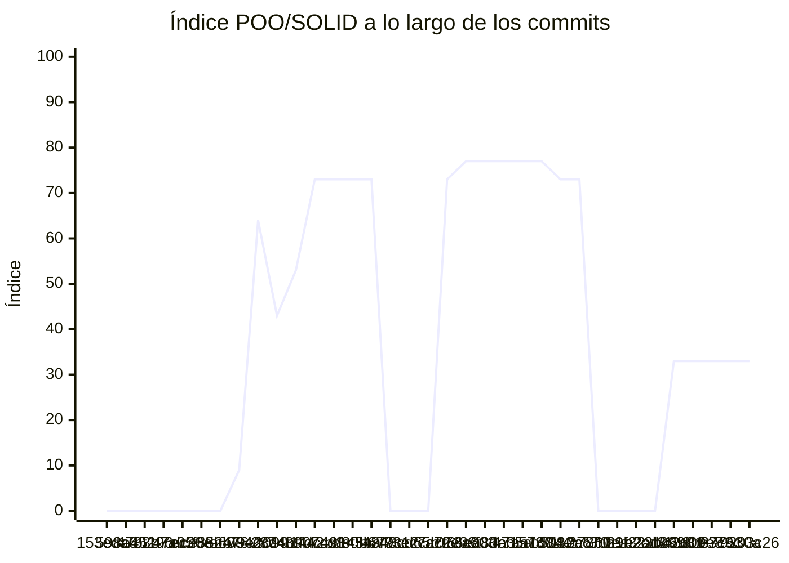

<!-- evaluacion:inicio -->
# Evaluación — equipo-xxx/Proyecto-XXX

> Documento **generado automáticamente** por la cátedra de Programación II (RepoSense + análisis de calidad POO/SOLID). **No editar a mano**: se regenera en cada evaluación.
> Rama evaluada: `main`. Análisis **heurístico** (regex + métricas): es una criba para orientar la revisión, **no una nota**.
> Generado: 2026-11-14.

## 1. Veredicto

| Aspecto | Resultado |
|---|---|
| Índice de calidad POO/SOLID | **33/100** |
| Código (LOC) | 590 |
| Archivos de código | 19 |
| Clases (bien usadas) | 19 (12 OK) |
| Código dentro de clases (%POO) | 100% |
| Funciones fuera de clases | 0 |
| Duplicación lógica | 24.9% |
| Señales S/O/L/I/D | 2/0/0/0/0 |
| Tope duro aplicado | `DUP>=15%` → índice ≤ 50 |

> Este informe **describe** lo que el análisis midió con los criterios ya establecidos de la materia. No es una nota.

### Semáforo de aprobación

Criterios de `CRITERIOS-CALIDAD.md`. **Aprobar** se juega con el perfil `estandar`; **destacar**, con el `exigente` (meta de excelencia).

| Semáforo | Resultado |
|---|---|
| Aprobar (`estandar`) | **no cumple** — 3/4 |
| Destacar (`exigente`) | **no cumple** — 2/5 |

**Criterios para aprobar**

| Criterio | Requisito | Tu resultado | Cumple |
|---|---|---|---|
| Código dentro de clases (%POO) | ≥ 85% | 100% | sí |
| Duplicación lógica | ≤ 10% | 24.9% | no |
| Funciones fuera de clases | ≤ 1 | 0 | sí |
| Señales POO/SOLID críticas | ninguna | ninguna | sí |

**Criterios para destacar**

| Criterio | Requisito | Tu resultado | Cumple |
|---|---|---|---|
| Código dentro de clases (%POO) | ≥ 95% | 100% | sí |
| Duplicación lógica | ≤ 5% | 24.9% | no |
| Funciones fuera de clases | ≤ 1 | 0 | sí |
| Señales POO/SOLID críticas | ninguna | Baja cohesión (LCOM), Complejidad alta | no |
| Índice de calidad POO/SOLID | ≥ 60 | 33/100 | no |

### Cómo se calcula el %POO (y por qué no sube solo)

`%POO = líneas de lógica dentro de clases ÷ líneas de lógica totales`.

Se cuentan las líneas de **lógica y campos**; no cuentan `package`/`import`/`using`/anotaciones ni comentarios, Javadoc o docstrings. Es una **proporción**: si agregás código nuevo dentro de una clase, el numerador y el denominador crecen juntos y el porcentaje casi no cambia.

Sube cuando el código que hoy está **fuera** de clases pasa a ser método de una clase (o desaparece): funciones sueltas, `main`, constantes de módulo, scripts y lógica de archivos sueltos. También importa que ese trabajo esté **integrado en `main`**: la evaluación siempre mide `main`, así que lo que sigue en otra rama no se refleja todavía.

## 2. Autoría (RepoSense)

| Autor | Commits | Código (LOC) | Tests (LOC) | Docs (LOC) | Días activos | % del código |
|---|---:|---:|---:|---:|---:|---:|
| htrillo-code | 3 | 104 | 0 | 1 | 1 | 86% |
| Mateo Cruz | 1 | 17 | 0 | 0 | 1 | 14% |

> _El LOC de autoría lo calcula RepoSense sobre el historial y puede diferir del LOC de código del análisis de calidad (que mira solo el estado de `main`)._

> **Reparto del trabajo:** htrillo-code concentra el 86% de las líneas de código. Un reparto muy desigual suele indicar que la integración no fue realmente en equipo; vale la pena reconstruir cómo se coordinó.

## 3. Fallas detectadas

Reúne lo que el análisis marcó y lo que todavía falta para cada semáforo. Cuando la señal se puede asociar a archivos, se indican para orientar la revisión. No es una nota.

| Falla | Tu resultado | Requisito | Archivos |
|---|---|---|---|
| Duplicación lógica | 24.9% | Aprobar: ≤ 10% Destacar: ≤ 5% | `codigo/areaa.gd` |
| Señales POO/SOLID críticas | Baja cohesión (LCOM), Complejidad alta | Destacar: ninguna | `codigo/cannon.gd`, `codigo/player.gd` |
| Índice de calidad POO/SOLID | 33/100 | Destacar: ≥ 60 | — |
| Métodos/funciones largos o con muchos parámetros | **1** método(s)/función(es) largos o con muchos parámetros | Sin señales | `indicador ataque.gd` |
| Campos públicos (encapsulación) | **5** clase(s) con campos públicos | Sin señales | `codigo/area2.gd`, `codigo/area3.gd`, `codigo/areaa.gd`, `codigo/cannon.gd`, `codigo/label_3d.gd` |

## 4. Aspectos evaluados

Cada aspecto indica **qué mide**, **por qué importa** y **tu resultado**. Cuando el análisis reportó una señal, se agregan preguntas para **investigar la causa** (no hay recetas: entender el porqué es parte de la evaluación).

### 1. Índice de calidad POO/SOLID (indice)

- **Qué mide:** Un resumen numérico (0-100) que combina la riqueza de clases bien usadas con la penalización por señales POO/SOLID y duplicación, y luego aplica topes duros.
- **Por qué importa:** Ordena y prioriza la revisión: un índice bajo indica varias señales que conviene mirar juntas.
- **Tu resultado:** índice **33/100**

### 2. Duplicación lógica (DRY) (duplicacion) — con señales

- **Qué mide:** Porcentaje de bloques de LÓGICA repetidos. Quedan fuera imports/includes, anotaciones, declaraciones de campos y comentarios/Javadoc/docstrings: esos bloques son boilerplate, no lógica.
- **Por qué importa:** Cada copia de lógica se mantiene por separado: un arreglo hay que repetirlo y los defectos se multiplican.
- **Tu resultado:** **24.9%** de duplicación lógica
- **Para investigar la causa:**
    - ¿El trabajo se repartió por pantallas o archivos y se integró copiando y pegando bloques?
    - ¿Qué zonas del sistema cambiaron juntas más de una vez (señal de lógica compartida)?
    - ¿Hubo un lugar común acordado para la lógica repetida antes de empezar, o cada integrante resolvió lo suyo?

### 3. Adopción de POO (% de código en clases) (poo) — sin señales

- **Qué mide:** Proporción de las **líneas de lógica** que viven dentro de una clase. Quedan fuera `package`/`import`/`using`/anotaciones y comentarios/Javadoc/docstrings: no son código que pueda estar dentro de una clase y, si contaran, el porcentaje quedaría topado por el boilerplate de cada archivo.
- **Por qué importa:** El diseño orientado a objetos es el eje de la materia: el comportamiento debería vivir como método de una clase.
- **Tu resultado:** **100.0%** del código dentro de clases
- **Cómo leerlo:** Es una **proporción**, no un acumulado: agregar código dentro de una clase no la sube por sí solo (numerador y denominador crecen juntos). Sube cuando el código que está **fuera** de clases (funciones sueltas, `main`, constantes de módulo, scripts) pasa a ser método de una clase o deja de existir. La medición se hace sobre `main`: el trabajo que todavía vive en otra rama no se refleja hasta que se integra.

### 4. Funciones fuera de clases (sueltas) — sin señales

- **Qué mide:** Funciones de nivel de módulo que no pertenecen a ninguna clase (en esta materia el comportamiento debe ser método de una clase).
- **Por qué importa:** Son la forma más directa de código procedural en un proyecto que debería ser orientado a objetos.
- **Tu resultado:** **0** función(es) fuera de clases

### 5. Clase demasiado grande (SRP) (god) — sin señales

- **Qué mide:** Clases con demasiadas líneas o métodos de LÓGICA. No cuentan los getters/setters triviales ni la cantidad de campos por sí sola.
- **Por qué importa:** Una clase que hace de todo cambia por muchos motivos y cuesta entenderla y probarla.
- **Tu resultado:** **0** clase(s) demasiado grande(s)

### 6. Baja cohesión (LCOM) (cohesion) — con señales

- **Qué mide:** Métodos y campos de una clase que casi no se relacionan entre sí.
- **Por qué importa:** Una unidad que cambia por motivos distintos y comparte poca información suele esconder más de una responsabilidad.
- **Tu resultado:** **1** clase(s) con baja cohesión
- **Para investigar la causa:**
    - ¿Qué métodos de la clase no comparten estado con el resto?
    - ¿Cambian por motivos distintos según la tarea?
    - ¿Se pensó su responsabilidad antes de escribirla, o se fue agregando?

### 7. Complejidad alta (complejidad) — con señales

- **Qué mide:** Complejidad ciclomática: cantidad de caminos posibles dentro de un método o función (condicionales, bucles, casos).
- **Por qué importa:** Muchos caminos = difícil de seguir y de probar; suelen esconderse casos sin cubrir.
- **Tu resultado:** **1** método(s)/función(es) con complejidad alta
- **Para investigar la causa:**
    - ¿Se agregaron condiciones a medida que aparecían casos nuevos?
    - ¿Se probaron todos los caminos o solo el caso principal?
    - ¿Hay reglas de negocio mezcladas con detalles técnicos?

### 8. Métodos/funciones largos o con muchos parámetros (tamano) — con señales

- **Qué mide:** Tamaño de los métodos/funciones y cantidad de parámetros.
- **Por qué importa:** Una función que hace varias cosas cuesta leerla, nombrarla y reutilizarla.
- **Tu resultado:** **1** método(s)/función(es) largos o con muchos parámetros
- **Para investigar la causa:**
    - ¿La función creció por acumulación de pasos?
    - ¿Agrupa operaciones que podrían describirse por separado?
    - ¿Los parámetros representan una misma idea (un objeto) o cosas sueltas?

### 9. Acoplamiento alto (CBO) (acoplamiento) — sin señales

- **Qué mide:** Cuánto depende una clase de otros tipos del proyecto. No cuentan los tipos de la plataforma (biblioteca estándar, DOM, motor Godot) ni los métodos/propiedades propias.
- **Por qué importa:** Piezas muy enlazadas hacen que un cambio se propague y que sea difícil reemplazar partes.
- **Tu resultado:** **0** clase(s) muy acoplada(s)

### 10. Herencia profunda (DIT) (herencia) — sin señales

- **Qué mide:** Profundidad de la cadena de herencia de una clase.
- **Por qué importa:** Jerarquías muy profundas vuelven difícil saber de dónde viene cada comportamiento.
- **Tu resultado:** **0** clase(s) con herencia profunda

### 11. Switch sobre tipos (OCP) (ocp) — sin señales

- **Qué mide:** Cadenas de dispatch por tipo (`else if ... is` / `else if ... instanceof`, `switch` sobre tipo o `typeof`). Un `is Tipo variable` aislado (pattern matching / cast seguro) NO cuenta como switch.
- **Por qué importa:** Cada tipo nuevo obliga a tocar varios lugares, en vez de extender con una implementación nueva.
- **Tu resultado:** **0** clase(s) con switch sobre tipos

### 12. Interfaz con demasiados métodos (ISP) (isp) — sin señales

- **Qué mide:** Interfaces o clases abstractas con muchos métodos declarados.
- **Por qué importa:** Obliga a implementar operaciones que no se usan y acopla a los clientes a métodos que no necesitan.
- **Tu resultado:** **0** interfaz(es) con demasiados métodos

### 13. Override vacío o 'no implementado' (LSP) (lsp) — sin señales

- **Qué mide:** Métodos sobrescritos que quedan vacíos o lanzan 'no implementado'.
- **Por qué importa:** Suele indicar que la jerarquía no representa bien el problema y rompe la sustitución entre clases.
- **Tu resultado:** **0** override(s) vacío(s) o 'no implementado'

### 14. Dependencia de concretos y falta de abstracciones (DIP) (dip) — sin señales

- **Qué mide:** Instanciación directa de clases **propias** concretas y ausencia de interfaces o clases abstractas pese al acoplamiento. No cuentan los structs ni los nodos/tipos del motor.
- **Por qué importa:** Depender de implementaciones concretas dificulta cambiar o probar una parte sin arrastrar las demás.
- **Tu resultado:** **0** dependencia(s) de concretos sin abstracciones

### 15. Clase sin métodos (solo datos) (data) — sin señales

- **Qué mide:** Clases que solo acumulan campos y no tienen comportamiento.
- **Por qué importa:** Separar datos de comportamiento reparte por el proyecto la lógica que debería estar cerca de esos datos.
- **Tu resultado:** **0** clase(s) sin métodos (solo datos)

### 16. Campos públicos (encapsulación) (encapsulacion) — con señales

- **Qué mide:** Clases que exponen campos sin control de acceso.
- **Por qué importa:** Expone el estado interno y hace que cualquier cambio dependa de quién lo modifica desde afuera.
- **Tu resultado:** **5** clase(s) con campos públicos
- **Para investigar la causa:**
    - ¿Se accede al campo desde otras clases para evitar un método?
    - ¿Qué reglas deberían respetarse al modificar ese estado?
    - ¿Los campos públicos se usan más como configuración que como estado?

### 17. Clase solo con métodos estáticos (utilitaria) (static) — sin señales

- **Qué mide:** Clases donde todos los métodos son estáticos.
- **Por qué importa:** Es comportamiento procedural disfrazado de clase: no se instancia ni participa del modelo de objetos.
- **Tu resultado:** **0** clase(s) solo con métodos estáticos

## 5. Evolución por commit

Métricas calculadas sobre el estado de `main` en **cada commit** (35 commits con trabajo), del primero al último. La calidad usa el perfil `exigente`; el aporte de código lo mide RepoSense. El índice puede **bajar** al crecer el proyecto: se acumulan señales.

| # | Fecha | Commit | Autor | LOC | Índice | %POO | Duplic. | Sueltas |
|---|---|---|---|---:|---:|---:|---:|---:|
| 1 | 2026-08-28 | `153eda6` | Juli | 0 | 0 | 0% | 0.0% | 0 |
| 2 | 2026-08-28 | `598e451` | dqmdz-etec | 0 | 0 | 0% | 0.0% | 0 |
| 3 | 2026-08-28 | `47bf296` | dqmdz-etec | 0 | 0 | 0% | 0.0% | 0 |
| 4 | 2026-08-28 | `83b7a05` | dqmdz-etec | 0 | 0 | 0% | 0.0% | 0 |
| 5 | 2026-10-16 | `47ec20e` | Juli | 0 | 0 | 0% | 0.0% | 0 |
| 6 | 2026-10-16 | `dce852b` | Juli | 531 | 0 | 87% | 55.2% | 0 |
| 7 | 2026-10-19 | `f58b476` | mafcruz | 531 | 0 | 87% | 55.2% | 0 |
| 8 | 2026-10-19 | `e6084dc` | Juli | 406 | 9 | 83% | 39.9% | 0 |
| 9 | 2026-10-19 | `79e2099` | Juli | 311 | 64 | 77% | 8.3% | 0 |
| 10 | 2026-10-19 | `28d4bff` | Juli | 199 | 43 | 100% | 12.5% | 0 |
| 11 | 2026-10-23 | `74f1442` | mafcruz | 210 | 53 | 100% | 11.8% | 0 |
| 12 | 2026-10-30 | `8907cd8` | Juli | 21 | 73 | 100% | 0.0% | 0 |
| 13 | 2026-10-30 | `dc49145` | mafcruz | 21 | 73 | 100% | 0.0% | 0 |
| 14 | 2026-10-30 | `bdef3ba` | mafcruz | 21 | 73 | 100% | 0.0% | 0 |
| 15 | 2026-10-30 | `80b679c` | mafcruz | 21 | 73 | 100% | 0.0% | 0 |
| 16 | 2026-10-30 | `48f7312` | mafcruz | 0 | 0 | 0% | 0.0% | 0 |
| 17 | 2026-10-30 | `48cd65b` | mafcruz | 0 | 0 | 0% | 0.0% | 0 |
| 18 | 2026-10-30 | `ec7c7f6` | dqmdz-etec | 0 | 0 | 0% | 0.0% | 0 |
| 19 | 2026-10-30 | `cac2e03` | mafcruz | 36 | 73 | 100% | 0.0% | 0 |
| 20 | 2026-11-02 | `073a603` | mafcruz | 42 | 77 | 100% | 0.0% | 0 |
| 21 | 2026-11-07 | `6ea80a3` | dqmdz-etec | 42 | 77 | 100% | 0.0% | 0 |
| 22 | 2026-11-07 | `f3deb5a` | dqmdz-etec | 42 | 77 | 100% | 0.0% | 0 |
| 23 | 2026-11-07 | `4715730` | dqmdz-etec | 42 | 77 | 100% | 0.0% | 0 |
| 24 | 2026-11-07 | `aa1d84e` | dqmdz-etec | 42 | 77 | 100% | 0.0% | 0 |
| 25 | 2026-11-13 | `b5082ac` | mafcruz | 36 | 73 | 100% | 0.0% | 0 |
| 26 | 2026-11-13 | `110c570` | mafcruz | 36 | 73 | 100% | 0.0% | 0 |
| 27 | 2026-11-13 | `27860ea` | mafcruz | 0 | 0 | 0% | 0.0% | 0 |
| 28 | 2026-11-13 | `3b21f32` | mafcruz | 0 | 0 | 0% | 0.0% | 0 |
| 29 | 2026-11-13 | `b9b2cd3` | mafcruz | 0 | 0 | 0% | 0.0% | 0 |
| 30 | 2026-11-13 | `e2ad099` | mafcruz | 0 | 0 | 0% | 0.0% | 0 |
| 31 | 2026-11-13 | `2bc6b81` | Juli | 590 | 33 | 100% | 24.9% | 0 |
| 32 | 2026-11-13 | `42d00e8` | dqmdz-etec | 590 | 33 | 100% | 24.9% | 0 |
| 33 | 2026-11-13 | `3be3c9c` | dqmdz-etec | 590 | 33 | 100% | 24.9% | 0 |
| 34 | 2026-11-13 | `877530a` | dqmdz-etec | 590 | 33 | 100% | 24.9% | 0 |
| 35 | 2026-11-13 | `9203c26` | dqmdz-etec | 590 | 33 | 100% | 24.9% | 0 |

---
_Informe generado por la cátedra. Los criterios y umbrales de medición corresponden al perfil `exigente` de `calidad.py`; el semáforo de aprobación, a `CRITERIOS-CALIDAD.md` (ver `README.md`). Ante dudas, revisá el archivo señalado._
<!-- evaluacion:fin -->
