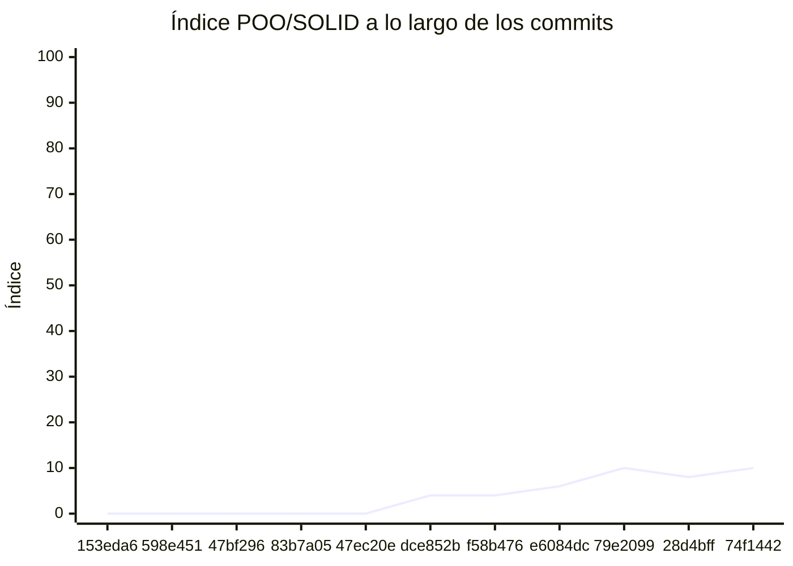

<!-- evaluacion:inicio -->
# Evaluación — equipo-xxx/Proyecto-XXX

> Documento **generado automáticamente** por la cátedra de Programación II (RepoSense + análisis de calidad POO/SOLID). **No editar a mano**: se regenera en cada evaluación.
> Rama evaluada: `main`. Análisis **heurístico** (regex + métricas): es una criba para orientar la revisión, **no una nota**.
> Generado: 2026-10-26.

## 1. Veredicto

| Aspecto | Resultado |
|---|---|
| Índice de calidad POO/SOLID | **10/100** |
| Código (LOC) | 210 |
| Archivos de código | 12 |
| Clases (bien usadas) | 12 (6 OK) |
| Código dentro de clases (%POO) | 100% |
| Funciones fuera de clases | 0 |
| Duplicación lógica | 11.8% |
| Señales S/O/L/I/D | 4/5/0/0/1 |

> Este informe **describe** lo que el análisis midió con los criterios ya establecidos de la materia. No es una nota.

### Semáforo de aprobación

Criterios de `CRITERIOS-CALIDAD.md`. **Aprobar** se juega con el perfil `estandar`; **destacar**, con el `exigente` (meta de excelencia).

| Semáforo | Resultado |
|---|---|
| Aprobar (`estandar`) | **no cumple** — 2/4 |
| Destacar (`exigente`) | **no cumple** — 2/5 |

**Criterios para aprobar**

| Criterio | Requisito | Tu resultado | Cumple |
|---|---|---|---|
| Código dentro de clases (%POO) | ≥ 85% | 100% | sí |
| Duplicación lógica | ≤ 10% | 11.8% | no |
| Funciones fuera de clases | ≤ 1 | 0 | sí |
| Señales POO/SOLID críticas | ninguna | Clase demasiado grande (SRP), Baja cohesión (LCOM), Acoplamiento alto (CBO) | no |

**Criterios para destacar**

| Criterio | Requisito | Tu resultado | Cumple |
|---|---|---|---|
| Código dentro de clases (%POO) | ≥ 95% | 100% | sí |
| Duplicación lógica | ≤ 5% | 11.8% | no |
| Funciones fuera de clases | ≤ 1 | 0 | sí |
| Señales POO/SOLID críticas | ninguna | Clase demasiado grande (SRP), Baja cohesión (LCOM), Complejidad alta, Acoplamiento alto (CBO), Switch sobre tipos (OCP) | no |
| Índice de calidad POO/SOLID | ≥ 60 | 10/100 | no |

## 2. Autoría (RepoSense)

| Autor | Commits | Código (LOC) | Tests (LOC) | Docs (LOC) | Días activos | % del código |
|---|---:|---:|---:|---:|---:|---:|
| htrillo-code | 3 | 104 | 0 | 1 | 1 | 86% |
| Mateo Cruz | 1 | 17 | 0 | 0 | 1 | 14% |

> _El LOC de autoría lo calcula RepoSense sobre el historial y puede diferir del LOC de código del análisis de calidad (que mira solo el estado de `main`)._

> **Reparto del trabajo:** htrillo-code concentra el 86% de las líneas de código. Un reparto muy desigual suele indicar que la integración no fue realmente en equipo; vale la pena reconstruir cómo se coordinó.

## 3. Aspectos evaluados

Cada aspecto indica **qué mide**, **por qué importa** y **tu resultado**. Cuando el análisis reportó una señal, se agregan preguntas para **investigar la causa** (no hay recetas: entender el porqué es parte de la evaluación).

### 1. Índice de calidad POO/SOLID (indice)

- **Qué mide:** Un resumen numérico (0-100) que combina la riqueza de clases bien usadas con la penalización por señales POO/SOLID y duplicación, y luego aplica topes duros.
- **Por qué importa:** Ordena y prioriza la revisión: un índice bajo indica varias señales que conviene mirar juntas.
- **Tu resultado:** índice **10/100**

### 2. Duplicación lógica (DRY) (duplicacion) — con señales

- **Qué mide:** Porcentaje de bloques de LÓGICA repetidos. Quedan fuera imports/includes, anotaciones, declaraciones de campos y comentarios/Javadoc/docstrings: esos bloques son boilerplate, no lógica.
- **Por qué importa:** Cada copia de lógica se mantiene por separado: un arreglo hay que repetirlo y los defectos se multiplican.
- **Tu resultado:** **11.8%** de duplicación lógica
- **Para investigar la causa:**
    - ¿El trabajo se repartió por pantallas o archivos y se integró copiando y pegando bloques?
    - ¿Qué zonas del sistema cambiaron juntas más de una vez (señal de lógica compartida)?
    - ¿Hubo un lugar común acordado para la lógica repetida antes de empezar, o cada integrante resolvió lo suyo?

### 3. Adopción de POO (% de código en clases) (poo) — sin señales

- **Qué mide:** Qué porción del código vive dentro de clases (no de funciones sueltas).
- **Por qué importa:** El diseño orientado a objetos es el eje de la materia: el comportamiento debería vivir como método de una clase.
- **Tu resultado:** **100.0%** del código dentro de clases

### 4. Funciones fuera de clases (sueltas) — sin señales

- **Qué mide:** Funciones de nivel de módulo que no pertenecen a ninguna clase (en esta materia el comportamiento debe ser método de una clase).
- **Por qué importa:** Son la forma más directa de código procedural en un proyecto que debería ser orientado a objetos.
- **Tu resultado:** **0** función(es) fuera de clases

### 5. Clase demasiado grande (SRP) (god) — con señales

- **Qué mide:** Clases con muchas líneas, métodos o campos a la vez.
- **Por qué importa:** Una clase que hace de todo cambia por muchos motivos y cuesta entenderla y probarla.
- **Tu resultado:** **1** clase(s) demasiado grande(s)
- **Para investigar la causa:**
    - ¿La clase creció por acumulación de responsabilidades?
    - ¿Qué partes de la clase se usan siempre juntas y cuáles no?
    - ¿Se podría describir su responsabilidad en una sola frase?

### 6. Baja cohesión (LCOM) (cohesion) — con señales

- **Qué mide:** Métodos y campos de una clase que casi no se relacionan entre sí.
- **Por qué importa:** Una unidad que cambia por motivos distintos y comparte poca información suele esconder más de una responsabilidad.
- **Tu resultado:** **2** clase(s) con baja cohesión
- **Para investigar la causa:**
    - ¿Qué métodos de la clase no comparten estado con el resto?
    - ¿Cambian por motivos distintos según la tarea?
    - ¿Se pensó su responsabilidad antes de escribirla, o se fue agregando?

### 7. Complejidad alta (complejidad) — con señales

- **Qué mide:** Complejidad ciclomática: cantidad de caminos posibles dentro de un método o función (condicionales, bucles, casos).
- **Por qué importa:** Muchos caminos = difícil de seguir y de probar; suelen esconderse casos sin cubrir.
- **Tu resultado:** **1** método(s)/función(es) con complejidad alta
- **Para investigar la causa:**
    - ¿Se agregaron condiciones a medida que aparecían casos nuevos?
    - ¿Se probaron todos los caminos o solo el caso principal?
    - ¿Hay reglas de negocio mezcladas con detalles técnicos?

### 8. Métodos/funciones largos o con muchos parámetros (tamano) — sin señales

- **Qué mide:** Tamaño de los métodos/funciones y cantidad de parámetros.
- **Por qué importa:** Una función que hace varias cosas cuesta leerla, nombrarla y reutilizarla.
- **Tu resultado:** **0** método(s)/función(es) largos o con muchos parámetros

### 9. Acoplamiento alto (CBO) (acoplamiento) — con señales

- **Qué mide:** Cuánto depende una clase de otros tipos del proyecto.
- **Por qué importa:** Piezas muy enlazadas hacen que un cambio se propague y que sea difícil reemplazar partes.
- **Tu resultado:** **5** clase(s) muy acoplada(s)
- **Para investigar la causa:**
    - ¿La clase conoce detalles internos de muchas otras?
    - ¿Se puede cambiar una parte sin tocar las demás?
    - ¿Los colaboradores llegan como parámetros o se crean por dentro?

### 10. Herencia profunda (DIT) (herencia) — sin señales

- **Qué mide:** Profundidad de la cadena de herencia de una clase.
- **Por qué importa:** Jerarquías muy profundas vuelven difícil saber de dónde viene cada comportamiento.
- **Tu resultado:** **0** clase(s) con herencia profunda

### 11. Switch sobre tipos (OCP) (ocp) — con señales

- **Qué mide:** Chequeos repetidos de tipo (`instanceof`/`is`/`typeof`) que equivalen a un switch sobre el tipo.
- **Por qué importa:** Cada tipo nuevo obliga a tocar varios lugares, en vez de extender con una implementación nueva.
- **Tu resultado:** **5** clase(s) con switch sobre tipos
- **Para investigar la causa:**
    - ¿Qué operación se resuelve preguntando el tipo?
    - ¿Qué se toca cada vez que aparece un tipo o caso nuevo?
    - ¿El comportamiento podría vivir en la propia jerarquía de tipos?

### 12. Interfaz con demasiados métodos (ISP) (isp) — sin señales

- **Qué mide:** Interfaces o clases abstractas con muchos métodos declarados.
- **Por qué importa:** Obliga a implementar operaciones que no se usan y acopla a los clientes a métodos que no necesitan.
- **Tu resultado:** **0** interfaz(es) con demasiados métodos

### 13. Override vacío o 'no implementado' (LSP) (lsp) — sin señales

- **Qué mide:** Métodos sobrescritos que quedan vacíos o lanzan 'no implementado'.
- **Por qué importa:** Suele indicar que la jerarquía no representa bien el problema y rompe la sustitución entre clases.
- **Tu resultado:** **0** override(s) vacío(s) o 'no implementado'

### 14. Dependencia de concretos y falta de abstracciones (DIP) (dip) — con señales

- **Qué mide:** Instanciación directa de clases concretas y ausencia de interfaces o clases abstractas pese al acoplamiento.
- **Por qué importa:** Depender de implementaciones concretas dificulta cambiar o probar una parte sin arrastrar las demás.
- **Tu resultado:** **1** dependencia(s) de concretos sin abstracciones
- **Para investigar la causa:**
    - ¿La clase crea por dentro a sus colaboradores en vez de recibirlos?
    - ¿Hay puntos de variación que convendría expresar como abstracción?
    - ¿Cómo se probaría esa clase cambiando una implementación?

### 15. Clase sin métodos (solo datos) (data) — sin señales

- **Qué mide:** Clases que solo acumulan campos y no tienen comportamiento.
- **Por qué importa:** Separar datos de comportamiento reparte por el proyecto la lógica que debería estar cerca de esos datos.
- **Tu resultado:** **0** clase(s) sin métodos (solo datos)

### 16. Campos públicos (encapsulación) (encapsulacion) — con señales

- **Qué mide:** Clases que exponen campos sin control de acceso.
- **Por qué importa:** Expone el estado interno y hace que cualquier cambio dependa de quién lo modifica desde afuera.
- **Tu resultado:** **4** clase(s) con campos públicos
- **Para investigar la causa:**
    - ¿Se accede al campo desde otras clases para evitar un método?
    - ¿Qué reglas deberían respetarse al modificar ese estado?
    - ¿Los campos públicos se usan más como configuración que como estado?

### 17. Clase solo con métodos estáticos (utilitaria) (static) — sin señales

- **Qué mide:** Clases donde todos los métodos son estáticos.
- **Por qué importa:** Es comportamiento procedural disfrazado de clase: no se instancia ni participa del modelo de objetos.
- **Tu resultado:** **0** clase(s) solo con métodos estáticos

## 4. Anexo: dónde mirar

Archivos donde el análisis encontró cada señal (sin número de línea, a propósito):

**Clase demasiado grande (SRP) (god)** — 1 archivo(s):
- `de-0-(copy)-(copy)/codigo/cannon.gd`

**Baja cohesión (LCOM) (cohesion)** — 2 archivo(s):
- `de-0-(copy)-(copy)/codigo/player.gd`
- `de-0-(copy)-(copy)/player.gd`

**Complejidad alta (complejidad)** — 1 archivo(s):
- `de-0-(copy)-(copy)/codigo/cannon.gd`

**Acoplamiento alto (CBO) (acoplamiento)** — 5 archivo(s):
- `de-0-(copy)-(copy)/areaa.gd`
- `de-0-(copy)-(copy)/cannon.gd`
- `de-0-(copy)-(copy)/codigo/cannon.gd`
- `de-0-(copy)-(copy)/codigo/player.gd`
- `de-0-(copy)-(copy)/player.gd`

**Switch sobre tipos (OCP) (ocp)** — 5 archivo(s):
- `de-0-(copy)-(copy)/areaa.gd`
- `de-0-(copy)-(copy)/cannon.gd`
- `de-0-(copy)-(copy)/codigo/cannon.gd`
- `de-0-(copy)-(copy)/codigo/player.gd`
- `de-0-(copy)-(copy)/player.gd`

**Campos públicos (encapsulación) (encapsulacion)** — 4 archivo(s):
- `de-0-(copy)-(copy)/cannon.gd`
- `de-0-(copy)-(copy)/codigo/cannon.gd`
- `de-0-(copy)-(copy)/codigo/player.gd`
- `de-0-(copy)-(copy)/player.gd`

## 5. Evolución por commit

Métricas calculadas sobre el estado de `main` en **cada commit** (11 commits con trabajo), del primero al último. La calidad usa el perfil `exigente`; el aporte de código lo mide RepoSense. El índice puede **bajar** al crecer el proyecto: se acumulan señales.

| # | Fecha | Commit | Autor | LOC | Índice | %POO | Duplic. | Sueltas |
|---|---|---|---|---:|---:|---:|---:|---:|
| 1 | 2026-08-28 | `153eda6` | Juli | 0 | 0 | 0% | 0.0% | 0 |
| 2 | 2026-08-28 | `598e451` | dqmdz-etec | 0 | 0 | 0% | 0.0% | 0 |
| 3 | 2026-08-28 | `47bf296` | dqmdz-etec | 0 | 0 | 0% | 0.0% | 0 |
| 4 | 2026-08-28 | `83b7a05` | dqmdz-etec | 0 | 0 | 0% | 0.0% | 0 |
| 5 | 2026-10-16 | `47ec20e` | Juli | 0 | 0 | 0% | 0.0% | 0 |
| 6 | 2026-10-16 | `dce852b` | Juli | 531 | 4 | 83% | 55.2% | 1 |
| 7 | 2026-10-19 | `f58b476` | mafcruz | 531 | 4 | 83% | 55.2% | 1 |
| 8 | 2026-10-19 | `e6084dc` | Juli | 406 | 6 | 78% | 39.9% | 1 |
| 9 | 2026-10-19 | `79e2099` | Juli | 311 | 10 | 72% | 8.3% | 1 |
| 10 | 2026-10-19 | `28d4bff` | Juli | 199 | 8 | 100% | 12.5% | 0 |
| 11 | 2026-10-23 | `74f1442` | mafcruz | 210 | 10 | 100% | 11.8% | 0 |

---
_Informe generado por la cátedra. Los criterios y umbrales de medición corresponden al perfil `exigente` de `calidad.py`; el semáforo de aprobación, a `CRITERIOS-CALIDAD.md` (ver `README.md`). Ante dudas, revisá el archivo señalado._
<!-- evaluacion:fin -->
